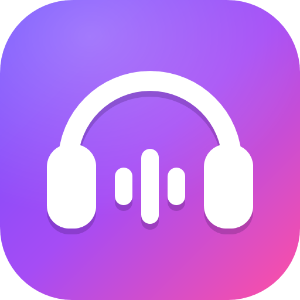
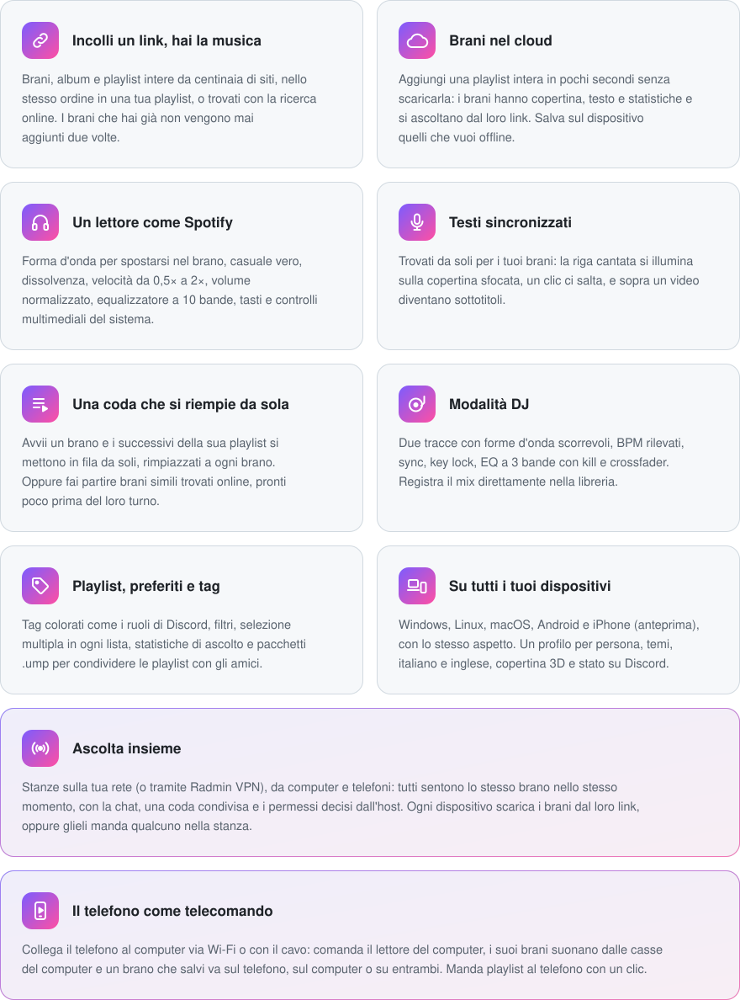
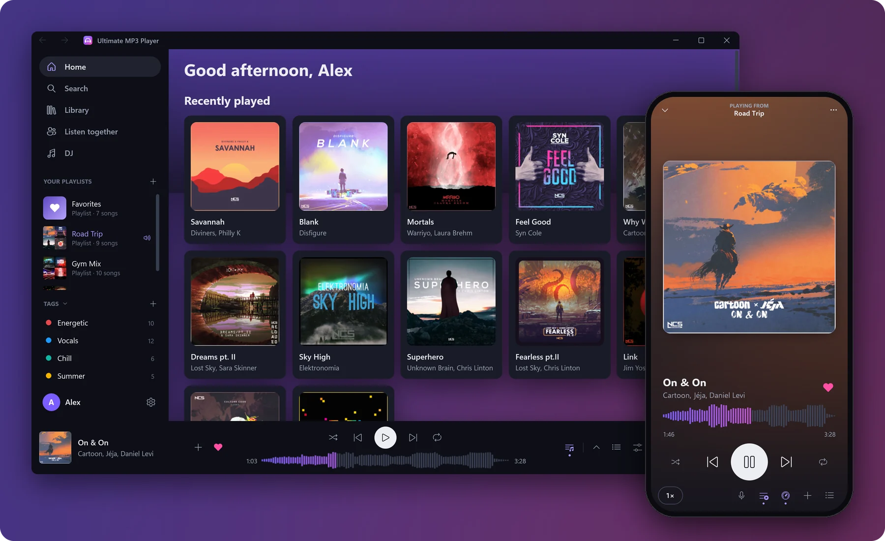
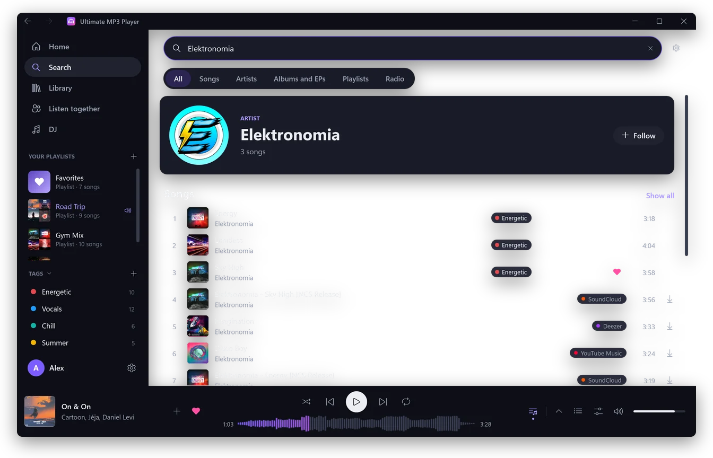
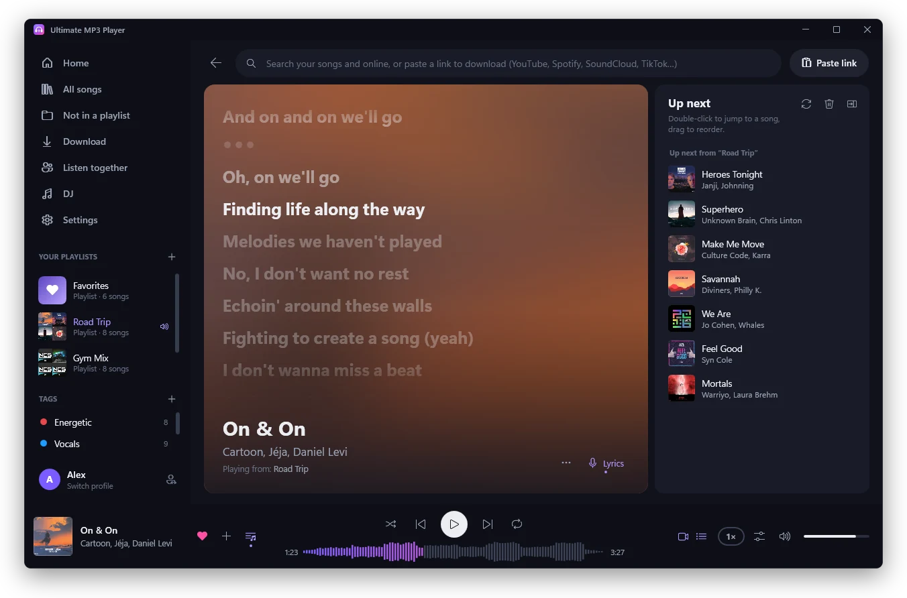
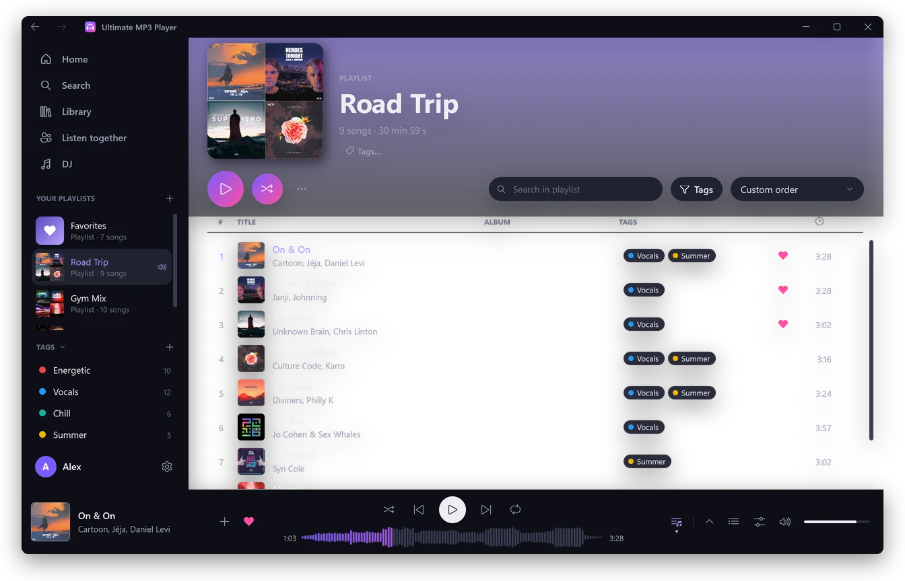
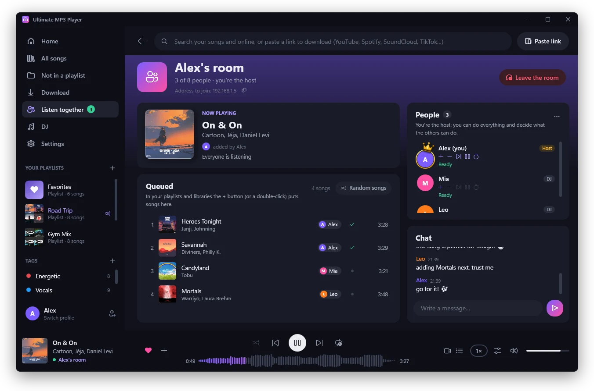
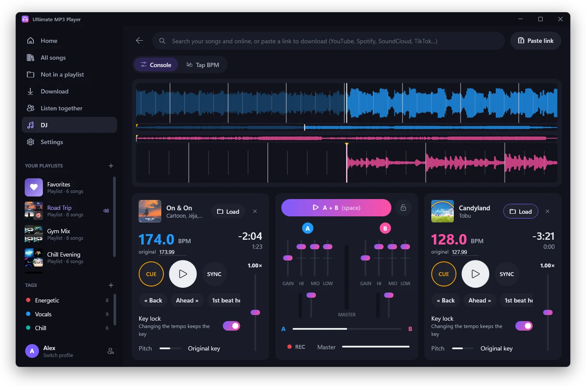
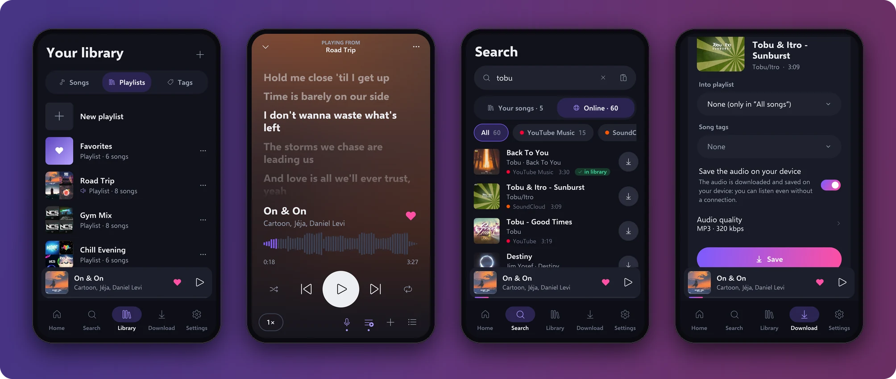
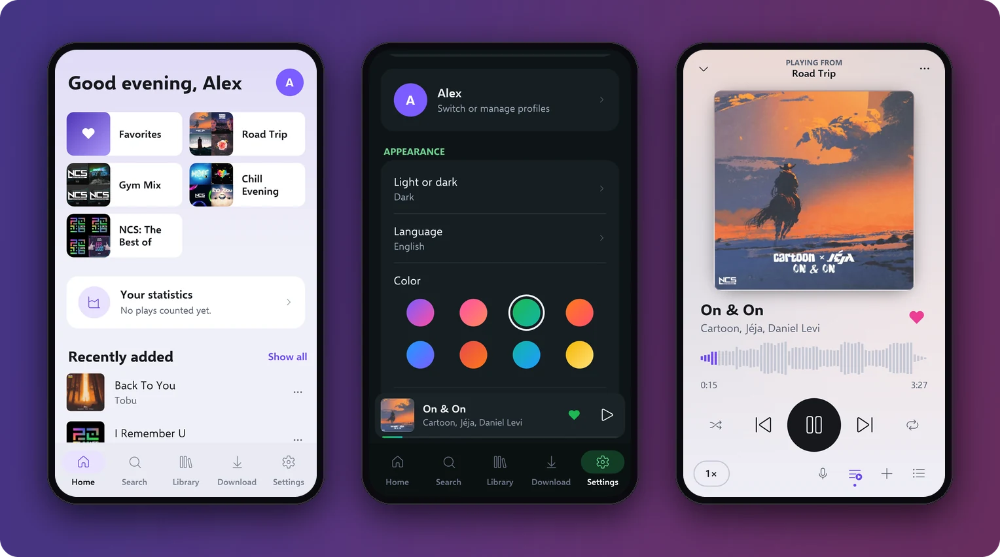

<p align="center">
  
</p>

<h1 align="center">Ultimate MP3 Player</h1>

<p align="center">
  <b>La tua musica, offline e senza pubblicità.</b><br>
  Incolla un link da YouTube Music, Spotify, Apple Music, SoundCloud, YouTube, TikTok, Instagram, Deezer, Bandcamp o
  centinaia di altri siti: i brani finiscono nella tua libreria con copertina e tag, pronti da ascoltare.
</p>

<p align="center">
  <a href="https://github.com/KirboHQ/UltimateMP3Player/releases/latest"></a>
  <a href="https://github.com/KirboHQ/UltimateMP3Player/releases"></a>
  
  
  
  
  
  
  <a href="LICENSE"></a>
</p>

<p align="center">
  <a href="https://github.com/KirboHQ/UltimateMP3Player/releases/latest">
    
  </a>
  <a href="https://github.com/KirboHQ/UltimateMP3Player/releases/latest">
    
  </a>
  <a href="https://github.com/KirboHQ/UltimateMP3Player/releases/latest">
    
  </a>
  <a href="https://github.com/KirboHQ/UltimateMP3Player/releases/latest">
    
  </a>
</p>

<p align="center"><a href="README.md">English</a> · <b>Italiano</b></p>

---

## ✨ In breve

<picture>
  <source media="(max-width: 640px) and (prefers-color-scheme: dark)" srcset="assets/readme/highlights-it-dark-mobile.svg">
  <source media="(max-width: 640px)" srcset="assets/readme/highlights-it-light-mobile.svg">
  <source media="(prefers-color-scheme: dark)" srcset="assets/readme/highlights-it-dark.svg">
  
</picture>



<sub>Profili di prova e musica di <a href="https://ncs.io">NoCopyrightSounds</a>. Chiaro e scuro, otto colori, la stessa app su
Windows, Linux, macOS, Android e iPhone (le schermate sono in inglese: l'app è anche in italiano).</sub>

## 🎵 Funzioni

### Download



- Link da YouTube Music, Spotify, Apple Music, SoundCloud, YouTube, TikTok, Instagram, Deezer, Bandcamp e centinaia
  di altri siti, grazie a yt-dlp e gallery-dl
- **Ricerca online** dentro l'app: YouTube Music, YouTube, SoundCloud e Deezer accanto ai tuoi brani; un clic apre il
  download
- Salvi l'audio sul dispositivo, oppure aggiungi solo i brani alla libreria nel cloud e li salvi dopo
- MP3 a 320, 256, 192 o 128 kbps o formato originale, video da 360p fino al 4K, scelti per ogni brano e ricordati;
  più download insieme
- *Scarica di nuovo / qualità…*: un brano salvato riscaricato in un'altra qualità, al posto dei suoi file
- Riconosce i doppioni (stessa fonte o stesso brano) e gestisce da solo i limiti dei siti: i download si mettono in
  pausa e riprendono più piano
- Un link che non si riesce a leggere, e i download non riusciti, si possono riprovare su YouTube Music
- Cookie del browser (facoltativi) per playlist private e contenuti con limite d'età (su Android e iPhone accedi ai
  siti direttamente dall'app)
- La musica che hai già: trascina file o cartelle nella finestra

### Lettore



- Forma d'onda, casuale vero, ripeti tutto / ripeti brano, dissolvenza da 1 a 12 secondi
- Velocità da 0,5× a 2×, cambiando o no anche il tono
- Volume normalizzato (−14 LUFS) ed equalizzatore a 10 bande con preset e curva di risposta
- **Testi sincronizzati**, trovati da soli: la riga cantata si illumina sui colori della copertina, un clic su una riga
  ci salta; sopra un video diventano sottotitoli
- Scegli dove va il suono (computer e Android): casse, cuffie, un DAC USB, un monitor in HDMI…; se lo scolleghi la
  musica passa a quello predefinito, e torna quando lo ricolleghi
- Tasti multimediali, controlli multimediali del sistema (Windows, MPRIS su Linux, "In riproduzione" su macOS e iPhone,
  la schermata di blocco su Android) e icona vicino all'orologio: chiudi la finestra e la musica continua usando
  pochissima memoria
- I brani con video lo mostrano nella schermata del brano, su uno sfondo sfocato di sé stesso; *Cerca il video…* ne
  trova uno su YouTube per gli altri

### Successivi

- Trascina per riordinare, doppio clic per saltare, lascia sul cestino per togliere
- Coda automatica, *Genera* e *Svuota*, pannello da nascondere di lato
- Brani simili trovati online dopo un brano, o i brani dell'artista: si scaricano poco prima del loro turno (quanti in
  anticipo lo scegli tu), e li tieni con il tasto destro
- Passaggio facoltativo a tempo del brano dopo: quello in riproduzione si porta ai suoi BPM senza cambiare tono
- Ritrovi tutto com'era quando riapri l'app

### Libreria



- **Brani nel cloud** accanto a quelli salvati: una libreria grande senza riempire il disco, salvata sul dispositivo
  solo dove vuoi tu (*Solo sul dispositivo*, *Salva tutti quelli nel cloud*)
- Playlist con copertina personalizzata, Preferiti, ascoltati di recente e la vista *Senza playlist* per fare ordine
- Tag colorati, filtri con più tag (tutti / almeno uno) e `#tag` nella ricerca
- Selezioni più brani, playlist o download in qualsiasi lista e agisci su tutti insieme
- *Elimina…* toglie solo il video, solo il testo, l'audio dal dispositivo o il brano intero, e mostra lo spazio
  liberato
- **Pacchetti `.ump`**: una playlist, un tag, più di uno o tutto in un solo file, con l'audio o con i soli link
  (abbastanza piccolo per Discord); lo apri o lo trascini sull'app per importarlo, senza doppioni dei brani che hai già
- **MP3 in una cartella** per una chiavetta, una scheda SD o l'auto: "Artista - Titolo.mp3" con tag e copertina
- Rinomina un artista su tutti i suoi brani in un colpo; modifica titolo, artista, album, BPM e copertina
- Statistiche di ascolto per profilo: ascolti, tempo e ultimo ascolto di ogni brano (anche quelli ascoltati nelle stanze
  e non salvati), i meno ascoltati per fare pulizia

### Ascolta insieme



- Le stanze sulla stessa rete (Wi-Fi o cavo) si trovano da sole, **con computer e telefoni** (Android e iPhone) nella
  stessa stanza; da lontano entrate tutti nella stessa rete di Radmin VPN. Una stanza può avere una password e un
  numero massimo di persone; si può entrare anche con l'indirizzo.
- Tutti sentono lo stesso brano allo stesso punto: comanda l'orologio dell'host, ogni dispositivo lo segue (volume ed
  equalizzatore restano i tuoi)
- Ogni dispositivo si procura il brano in riproduzione e i due dopo: dalla sua libreria, dalla memoria delle stanze, dal
  link del brano, oppure glielo manda qualcuno nella stanza. Un brano parte quando ce l'hanno tutti (o dopo qualche
  secondo per chi ce l'ha); chi arriva dopo entra al punto giusto.
- L'host decide chi può aggiungere, togliere e spostare, saltare, mettere in pausa, andare avanti e indietro; per gli
  altri i tasti sono oscurati. In una stanza i tasti play delle tue liste diventano **+** e il doppio clic mette il
  brano nella stanza; sul telefono basta toccare un brano (tienilo premuto per altro).
- Chat, chi ha aggiunto ogni brano, l'avanzamento dei download di tutti, espulsioni, passaggio dell'host. Se l'host
  esce o il suo dispositivo si spegne, la stanza passa a chi ha più permessi (a parità, a chi è entrato per primo).
- Sul telefono, la scheda **Insieme**: le stanze vicine o una tua, poi la coda, le persone e la chat. Quando un'altra
  app prende l'audio (un video, una chiamata), la stanza va avanti in silenzio sul telefono: premi play per risentirla.
- I brani ascoltati nelle stanze restano in memoria (10 di base, insieme ai consigliati); quelli che ti piacciono li
  salvi nella libreria o in una playlist
- Il P2P si può spegnere dalle impostazioni: i brani arrivano allora solo dalla tua libreria, dalla memoria o dal loro
  link

> [!TIP]
> La prima volta Windows chiede se l'app può usare la rete: consenti l'accesso. Con Radmin VPN spunta anche *Reti
> pubbliche*, oppure usa **Consenti nel firewall** nell'app. Radmin VPN esiste solo per Windows: con amici su Linux o
> macOS usate ZeroTier o Tailscale, che vanno ovunque (anche su Windows).

### DJ



- Due tracce con forme d'onda scorrevoli e panoramica, CUE, avanti/indietro, range del tempo ±8 / 16 / 50 %, key lock
- Un selettore dei brani per ogni traccia: libreria, playlist, tag, il brano in riproduzione o un file
- BPM rilevati in automatico, TAP su ogni traccia (anche con il tasto T), griglia dei beat e SYNC di tempo e fase
- Mixer con EQ a 3 bande e kill, fader dei canali e crossfader
- Registra il mix e salvalo come MP3 nella libreria, anche in una playlist nuova

### Sul telefono



- La stessa libreria, playlist, tag, testi, equalizzatore e download su Android e iPhone
- Cerca e scarica in un'unica scheda: scrivi per trovare i tuoi brani e la musica online, incolla un link per scaricarlo
- Condividi un link da YouTube, Spotify, SoundCloud o quasi ogni altra app con *Scarica con Ultimate MP3 Player*
- **Trascina un brano verso destra per aggiungerlo alla coda**, come su Spotify
- Scorri di lato per passare da una scheda all'altra, veloce quanto vuoi; dentro una playlist uno scorrimento dal bordo
  sinistro torna indietro
- Tocca *Aggiungi brani* su un tag per spuntare i suoi brani da tutta la libreria
- Accedi ai siti dall'app per le playlist private; il brano sulla schermata di blocco e i tasti delle cuffie
- *Ascolta insieme* in una scheda tutta sua, con computer e altri telefoni

### Il telefono come telecomando

- Sul telefono apri *Impostazioni › Collega al computer*, sul computer *Impostazioni › Collega telefono* e sceglilo.
  Sulla stessa Wi-Fi il telefono lo consente una volta; con il cavo non c'è niente da consentire (Android: attiva il
  tethering USB; iPhone: Dispositivi Apple o iTunes su Windows, `usbmuxd` su Linux, niente da aggiungere su Mac).
- Il telefono comanda il lettore del computer: play, salto, posizione, la coda e il volume del computer, anche dalla
  schermata di blocco. La musica suona sul computer, sul telefono o su entrambi, sincronizzata.
- Ciascuno mostra la musica dell'altro: fai partire una playlist del telefono o del computer da uno qualsiasi dei due,
  oppure mostra la musica di un solo dispositivo (il profilo in basso a sinistra si adegua). I brani che un dispositivo
  non ha arrivano tramite la rete o il cavo
- Salvare un brano mentre sono collegati chiede dove: sul telefono, sul computer o su entrambi; con le due librerie
  insieme lo chiedono anche il cuore e le nuove playlist e i nuovi tag, e un'icona di telefono o computer distingue
  le loro playlist e i loro tag
- **Al telefono** nella finestra di esportazione del computer manda playlist e tag al telefono, che prende solo i brani
  che non ha
- Se la connessione cade torna da sola; entrare in una stanza o aprire il DJ scollega il telefono

### E poi



- La stessa app su Windows, Linux, macOS, Android e iPhone
- Profili come in Chrome, ognuno con le sue playlist, i preferiti, l'equalizzatore, il colore e l'aspetto chiaro o scuro
- Italiano e inglese, animazioni e scorrimento fluidi
- Stato su Discord con brano, artista, copertina e barra di avanzamento
- Aggiornamenti automatici dalle release di GitHub

## 📥 Installazione

**Windows**

1. Scarica **`UltimateMP3Player-windows-x64-setup.exe`** (o `-arm64-setup.exe` per Windows 11 su ARM, come i portatili
   Snapdragon) dall'[ultima release](https://github.com/KirboHQ/UltimateMP3Player/releases/latest).
2. Avvialo: niente diritti di amministratore e nient'altro da installare. Ti chiede la lingua (italiano o inglese,
   si cambia poi dalle impostazioni).
3. Fatto: l'app si aggiorna da sola dalle release.

> [!NOTE]
> Windows SmartScreen può dire che l'app non è riconosciuta, perché non è firmata con un certificato a pagamento:
> clicca **Ulteriori informazioni → Esegui comunque**.

**Linux** (x64 o arm64, qualsiasi distribuzione recente con un desktop)

1. Scarica **`UltimateMP3Player-linux-x64.tar.gz`** (o `-arm64`) dall'[ultima release](https://github.com/KirboHQ/UltimateMP3Player/releases/latest).
2. Estrailo in una tua cartella (non in una di sistema come `/opt`: l'app si aggiorna lì dentro), per esempio:
   ```sh
   mkdir -p ~/.local/opt
   tar -xzf UltimateMP3Player-linux-x64.tar.gz -C ~/.local/opt
   ```
3. Avviala una volta con `~/.local/opt/UltimateMP3Player/UltimateMP3Player`: da lì in poi è nel menu delle
   applicazioni e i pacchetti `.ump` si aprono con lei. Al primo avvio scarica da sola yt-dlp, ffmpeg e gli altri
   motori.

> [!NOTE]
> Su GNOME "puro" l'icona vicino all'orologio richiede l'estensione *AppIndicator* (Ubuntu ce l'ha già); senza,
> chiudere la finestra chiude l'app. Se l'app non parte e nomina ICU, installa il pacchetto `libicu` della tua
> distribuzione.

**macOS** (12 Monterey o successivo)

1. Scarica **`UltimateMP3Player-macos-arm64.zip`** per Apple Silicon (M1 e successivi) o `-x64` per i Mac Intel
   dall'[ultima release](https://github.com/KirboHQ/UltimateMP3Player/releases/latest).
2. Apri lo zip e trascina **Ultimate MP3 Player** in *Applicazioni*.
3. La prima volta macOS dice che non può verificare l'app, perché non è firmata con un certificato Apple a pagamento:
   apri **Impostazioni di Sistema → Privacy e sicurezza** e clicca **Apri comunque** (sulle versioni più vecchie: tasto
   destro sull'app → **Apri**).

> [!NOTE]
> Se macOS dice che l'app "è danneggiata", esegui una volta nel Terminale:
> `xattr -dr com.apple.quarantine "/Applications/Ultimate MP3 Player.app"`

**Android** (8 o successivo; non è sul Play Store)

1. Dal telefono apri l'[ultima release](https://github.com/KirboHQ/UltimateMP3Player/releases/latest) e scarica
   **`UltimateMP3Player-android-arm64-v8a.apk`** (quasi tutti i telefoni degli ultimi anni; `-armeabi-v7a` è per i
   vecchi telefoni a 32 bit, `-x86_64` per emulatori e Chromebook).
2. Apri il file scaricato. La prima volta Android chiede di consentire l'installazione di app dal browser (o dal
   gestore file): consentila, torna indietro e premi **Installa**.
3. Fatto. Al primo avvio l'app prepara i suoi motori (pochi secondi), poi si aggiorna da sola: le nuove versioni si
   scaricano con il Wi-Fi e Android chiede prima di installarle.

> [!NOTE]
> Play Protect può dire che l'app è sconosciuta, perché non arriva dal Play Store: premi **Altri dettagli → Installa
> comunque**. La musica resta nella cartella dell'app (*Android › data*, visibile dal computer); se disinstalli l'app,
> Android chiede se tenerla. Per spostare la musica su un altro telefono o computer usa un pacchetto `.ump`.

**iPhone e iPad** (iOS 15 o successivo; non è sull'App Store)

1. Installa **SideStore** dal tuo PC Windows (o Mac) seguendo la guida ufficiale su [sidestore.io](https://sidestore.io):
   installa app firmate con il tuo Apple ID gratuito, senza Mac e senza jailbreak. Poi attiva la **Modalità
   sviluppatore** (Impostazioni › Privacy e sicurezza, in fondo; l'iPhone si riavvia).
2. In SideStore apri **Sources**, premi **+** e aggiungi
   `https://github.com/KirboHQ/UltimateMP3Player/releases/latest/download/sidestore-source.json`, poi installa
   **Ultimate MP3 Player** da lì. (Oppure scarica `UltimateMP3Player-ios.ipa` dall'[ultima
   release](https://github.com/KirboHQ/UltimateMP3Player/releases/latest) e aprilo con SideStore.)
3. Le nuove versioni compaiono in SideStore (**My Apps › Update**); l'app te lo dice in Impostazioni › Aggiornamenti
   quando ce n'è una.

> [!NOTE]
> Con un Apple ID gratuito un'app resta firmata 7 giorni e SideStore la rinnova da solo (aprilo ogni tanto), e possono
> essere attive al massimo 3 app installate così, SideStore compreso. I tuoi brani sono nell'app File (*Sul mio iPhone ›
> Ultimate MP3 Player › Music*): aggiungine altri da Impostazioni › Libreria. Disinstallando l'app vengono cancellati:
> tieni un pacchetto `.ump`. I download vogliono l'app aperta: in background iOS lascia a un'app solo mezzo minuto
> circa per finirli. Per mandare un link da un'altra app, crea un Comando rapido che prende l'URL condiviso e apre
> `ump://add?url=` seguito da quello. La prima volta che cerchi le stanze o ti colleghi a un computer, iOS chiede di
> trovare i dispositivi sulla rete locale: consenti.

## 💬 Aiuto e segnalazioni

Hai trovato un problema o hai un'idea? Apri una [segnalazione](https://github.com/KirboHQ/UltimateMP3Player/issues),
oppure usa **Impostazioni → Aiuto e supporto** nell'app: scrive già lei la versione dell'app e di Windows.

## 🛠️ Compilare

<details>
<summary>Requisiti, comandi e struttura del progetto</summary>
<br>

Serve il .NET 8 SDK, e per l'installer Inno Setup 6. I programmi esterni vanno in `engines\` (vedi
[engines/README.md](engines/README.md)).

| Comando | Risultato |
|---|---|
| `.\build.ps1` | App portatile in `app\` e collegamento sul Desktop |
| `.\build.ps1 -Installer` | `installer\Output\UltimateMP3Player-windows-x64-setup.exe` e `-windows-arm64-setup.exe` |
| `.\build.ps1 -Release` | `dist\`: i file da allegare a una release di GitHub: `UltimateMP3Player-windows-x64-setup.exe` e `-windows-arm64-setup.exe` (più `UltimateMP3Player-windows-x64.exe` e `-windows-arm64.exe`, facoltativi, per aggiornamenti più leggeri, e `legacy\UltimateMP3Player.exe`, l'exe x64 con il nome che cercano le versioni fino alla 3.6), i pacchetti per Linux e macOS e gli APK per Android (`-WindowsOnly` salta entrambi, `-NoAndroid` solo gli APK) |
| `.\build-unix.ps1` | Solo i pacchetti per Linux e macOS in `dist\`: `UltimateMP3Player-linux-x64.tar.gz`, `-linux-arm64.tar.gz`, `UltimateMP3Player-macos-x64.zip`, `-macos-arm64.zip` (`-Targets linux-x64,…` per farne solo alcuni) |
| `.\build-android.ps1` | Solo gli APK per Android in `dist\android\`: `UltimateMP3Player-android-arm64-v8a.apk`, `-armeabi-v7a.apk`, `-x86_64.apk` (`-Out <cartella>` per metterli altrove) |

L'app Android richiede il .NET 10 SDK con il workload Android (`dotnet workload install android`), l'Android SDK e un
JDK (`ANDROID_HOME` / `JAVA_HOME`, oppure `%LOCALAPPDATA%\Android\Sdk` e `\Android\jdk`). I suoi motori (Python con
yt-dlp, ffmpeg e QuickJS di [youtubedl-android](https://github.com/JunkFood02/youtubedl-android)) li scarica
`tools\android-deps.ps1`, con versione e SHA-256 fissati. La prima compilazione crea la chiave di firma in
`%USERPROFILE%\.ultimatemp3player-android`, fuori dal repository: **tienine una copia** — Android installa un
aggiornamento solo se è firmato con la stessa chiave.

Anche i pacchetti per Linux e macOS si fanno da Windows. L'app per macOS è firmata "ad hoc" (senza un certificato
Apple) con [rcodesign](https://github.com/indygreg/apple-platform-rs), scaricato una volta in `tools\bin`: i Mac Apple
Silicon non avviano app senza nessuna firma. La versione in `src\UltimateMP3Player.Avalonia\UltimateMP3Player.Avalonia.csproj`
va tenuta uguale a quella di Windows (e di Android e iPhone, in `src\UltimateMP3Player.Android\UltimateMP3Player.Android.csproj`
e `src\UltimateMP3Player.iOS\UltimateMP3Player.iOS.csproj`).

L'app per iPhone ha bisogno di Xcode, quindi la compila GitHub Actions su macOS ([.github/workflows/ios.yml](.github/workflows/ios.yml)):
quando pubblichi una release le allega `UltimateMP3Player-ios.ipa` (non firmata: la firma SideStore sul telefono) e
`sidestore-source.json`; lanciando il workflow a mano (*Actions › iOS › Run workflow*) li trovi tra gli artifact
dell'esecuzione, senza toccare le release. I suoi motori (Python per iOS da python.org, yt-dlp, certifi e LAME
compilato per l'iPhone) li scarica e li mette nell'app `tools/ios-deps.sh`, con versione e SHA-256 fissati, nello stesso
workflow. Su Windows `dotnet build src\UltimateMP3Player.iOS` con l'SDK .NET 10 e il workload iOS
(`dotnet workload install ios`) controlla il codice.

Due impostazioni in `src\UltimateMP3Player\UltimateMP3Player.csproj` (e le stesse due nel progetto Avalonia):

- `<GitHubRepo>proprietario/repo</GitHubRepo>`: dove l'app cerca gli aggiornamenti e apre le segnalazioni. L'ultima
  release deve contenere i setup; se contiene anche `UltimateMP3Player-windows-x64.exe` e `-arm64.exe`, gli aggiornamenti
  scaricano solo quelli (70-80 MB invece dell'intero setup). Ogni PC prende i file del suo processore (un'installazione x64
  su un PC ARM passa a quelli ARM). Le versioni fino alla 3.6 conoscono solo i vecchi nomi: per qualche release
  allega anche `dist\legacy\UltimateMP3Player.exe`, così si aggiornano.
- `<DiscordAppId>…</DiscordAppId>`: l'applicazione Discord usata per lo stato.

`UMP_DATA=<cartella>` avvia una copia di prova con dati suoi, accanto a quella normale. `src\Mp3Cli` è un programma
da riga di comando per provare il core (download, import, coda, casuale).

| Cartella | Contenuto |
|---|---|
| `src\UltimateMP3Player.Core` | Download (yt-dlp, gallery-dl, ffmpeg), libreria, profili, coda, analisi, traduzioni |
| `src\UltimateMP3Player` | Interfaccia WPF, motore audio (NAudio/WASAPI), motore DJ (SoundTouch), icona, tasti multimediali, aggiornamenti, Discord |
| `src\UltimateMP3Player.Avalonia` | Linux e macOS: la stessa interfaccia disegnata con Avalonia; usa i view model, i motori audio e DJ e gran parte dei servizi di `src\UltimateMP3Player` (uscita audio con SDL3, MPRIS, "In riproduzione" di macOS, aggiornamenti) |
| `src\UltimateMP3Player.Android` | Android: le pagine per il telefono (Avalonia), con i view model, il motore audio e i pezzi delle viste di Linux/macOS in comune; il servizio del lettore con i controlli nella notifica e nella schermata di blocco (MediaSession), l'uscita audio con AudioTrack, i motori dentro l'app, la condivisione, gli aggiornamenti |
| `src\UltimateMP3Player.iOS` | iPhone e iPad: le pagine e i pezzi per il telefono dell'app Android (collegati), con l'uscita audio di iOS (AudioQueue), decodifica e tag (AudioToolbox, AVFoundation), "In riproduzione", l'app File; yt-dlp dentro l'app (Python incorporato, JavaScriptCore per YouTube), MP3 con LAME |
| `installer` | Script di Inno Setup e immagini dell'installazione (`tools\make-images.ps1` le crea da `Logo.xaml`, insieme alle icone per macOS) |

</details>

## 📁 Dove sono i tuoi dati

| Percorso | Contenuto |
|---|---|
| `Musica\Ultimate MP3 Player` | Brani salvati sul dispositivo (MP3/M4A con tag e copertina) e video |
| `%LOCALAPPDATA%\Ultimate MP3 Player` | Libreria, copertine, testi, profili, impostazioni, `errors.log` |
| `%LOCALAPPDATA%\Ultimate MP3 Player\cache` | Memoria temporanea: brani nel cloud, consigliati e delle stanze di *Ascolta insieme* che hai ascoltato, tenuti per la prossima volta |

Su Linux i dati sono in `~/.local/share/Ultimate MP3 Player` e su macOS in `~/Library/Application Support/Ultimate MP3 Player`
(lì ci sono anche i motori, in `engines`); i brani vanno in `~/Music/Ultimate MP3 Player`. Su Android i brani sono nella
cartella dell'app `Android/data/com.kirbohq.ultimatemp3player/files/Music` (visibile dal computer), il resto dentro
l'app. Su iPhone i brani e `errors.log` sono nell'app File (*Sul mio iPhone › Ultimate MP3 Player*), il resto dentro
l'app.

## 🙏 Software di terze parti

[yt-dlp](https://github.com/yt-dlp/yt-dlp) (Unlicense), [gallery-dl](https://github.com/mikf/gallery-dl) (GPL-2.0),
[FFmpeg](https://ffmpeg.org) (GPL, build da [yt-dlp/FFmpeg-Builds](https://github.com/yt-dlp/FFmpeg-Builds), su Linux
e macOS da [martin-riedl.de](https://ffmpeg.martin-riedl.de)),
[Deno](https://deno.com) (MIT), [NAudio](https://github.com/naudio/NAudio) (MIT),
[SoundTouch.Net](https://github.com/owoudenberg/soundtouch.net) (LGPL-2.1).
Linux e macOS: [Avalonia](https://avaloniaui.net) (MIT), [SDL3](https://www.libsdl.org) (zlib) tramite
[SDL3-CS](https://github.com/ppy/SDL3-CS) (MIT), [Tmds.DBus](https://github.com/tmds/Tmds.DBus) (MIT),
[NLayer](https://github.com/naudio/NLayer) (MIT),
[Fluent System Icons](https://github.com/microsoft/fluentui-system-icons) (MIT) e
[Selawik](https://github.com/microsoft/Selawik) (OFL-1.1), al posto di Segoe UI e delle sue icone.
Android: gli stessi, più [youtubedl-android](https://github.com/JunkFood02/youtubedl-android) (GPL-3.0) per Python,
FFmpeg e [QuickJS](https://bellard.org/quickjs/) (MIT) compilati per Android. iPhone: Avalonia, NAudio, NLayer,
SoundTouch.Net e gli stessi caratteri e icone, yt-dlp, [Python](https://www.python.org) (PSF License),
[certifi](https://github.com/certifi/python-certifi) (MPL-2.0) e [LAME](https://lame.sourceforge.io) (LGPL).

Le loro licenze, gli avvisi di copyright e dove trovare il codice sorgente di ciascuno sono in
[licenses/THIRD-PARTY-NOTICES.txt](licenses/THIRD-PARTY-NOTICES.txt), che arriva anche insieme all'app (la cartella
`licenses`).

## 📄 Licenza

Ultimate MP3 Player è software libero, distribuito con la [GNU General Public License v3.0](LICENSE) o qualsiasi
versione successiva: puoi usarlo, studiarlo, condividerlo e modificarlo, e se condividi una versione modificata deve
restare con la stessa licenza, insieme al suo codice sorgente. Vale anche per le versioni uscite prima che la licenza
venisse aggiunta.

<sub>Scarica solo contenuti che hai il diritto di scaricare.</sub>
