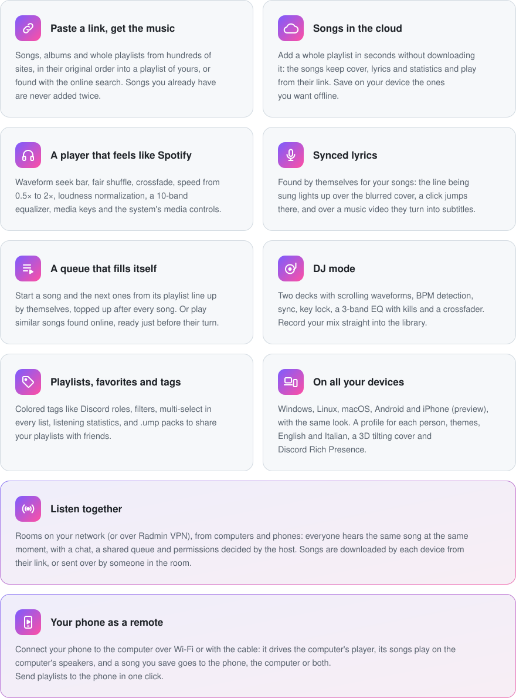

<p align="center">
  
</p>

<h1 align="center">Ultimate MP3 Player</h1>

<p align="center">
  <b>Your music, offline and ad-free.</b><br>
  Paste a link from YouTube Music, Spotify, Apple Music, SoundCloud, YouTube, TikTok, Instagram, Deezer, Bandcamp or
  hundreds of other sites: the songs land in your library with covers and tags, ready to play.
</p>

<p align="center">
  <a href="https://github.com/KirboHQ/UltimateMP3Player/releases/latest"></a>
  <a href="https://github.com/KirboHQ/UltimateMP3Player/releases"></a>
  
  
  
  
  
  
  <a href="LICENSE"></a>
</p>

<p align="center">
  <a href="https://github.com/KirboHQ/UltimateMP3Player/releases/latest">
    
  </a>
  <a href="https://github.com/KirboHQ/UltimateMP3Player/releases/latest">
    
  </a>
  <a href="https://github.com/KirboHQ/UltimateMP3Player/releases/latest">
    
  </a>
  <a href="https://github.com/KirboHQ/UltimateMP3Player/releases/latest">
    
  </a>
</p>

<p align="center"><b>English</b> · <a href="README.it.md">Italiano</a></p>

---

## ✨ Highlights

<picture>
  <source media="(max-width: 640px) and (prefers-color-scheme: dark)" srcset="assets/readme/highlights-en-dark-mobile.svg">
  <source media="(max-width: 640px)" srcset="assets/readme/highlights-en-light-mobile.svg">
  <source media="(prefers-color-scheme: dark)" srcset="assets/readme/highlights-en-dark.svg">
  
</picture>


<sub>Demo profiles and music by <a href="https://ncs.io">NoCopyrightSounds</a>. Light and dark, eight colours, the same app on
Windows, Linux, macOS, Android and iPhone.</sub>

## 🎵 Features

### Downloads


- Links from YouTube Music, Spotify, Apple Music, SoundCloud, YouTube, TikTok, Instagram, Deezer, Bandcamp and
  hundreds of other sites, powered by yt-dlp and gallery-dl
- **Online search** inside the app: YouTube Music, YouTube, SoundCloud and Deezer next to your own songs; a click opens
  the download
- Save the audio on your device, or just add the songs to your library in the cloud and save them later
- MP3 at 320, 256, 192 or 128 kbps or the original format, videos from 360p up to 4K, chosen for each song and remembered;
  several downloads at a time
- *Download again / quality…*: a saved song downloaded again in another quality, in place of its files
- Duplicates are recognized (same source or same song), and site rate limits are handled by themselves: downloads
  pause, then resume more gently
- A link that can't be read, and failed downloads, can be retried on YouTube Music
- Optional browser cookies for private playlists and age-restricted content (on Android and iPhone you sign in to the
  sites inside the app)
- Music you already have: drag files or folders into the window

### Player


- Waveform seek bar, fair shuffle, repeat all / repeat one, crossfade from 1 to 12 seconds
- Speed from 0.5× to 2×, with or without changing the pitch
- Loudness normalization (−14 LUFS) and a 10-band equalizer with presets and a live response curve
- **Synced lyrics**, found by themselves: the line being sung lights up over the cover's colors, click a line to jump
  there; over a video they become subtitles
- Choose where the sound goes (computers and Android): speakers, headphones, a USB DAC, a monitor over HDMI…; if it's unplugged the music moves to
  the default one, and goes back when it's plugged in again
- Media keys, the system's media controls (Windows, MPRIS on Linux, Now Playing on macOS and iPhone, the lock screen on Android)
  and the tray: close the window and the music keeps playing with very little memory
- Songs with a video show it in the song screen, framed on a blurred copy of itself; *Find the video…* gets one from
  YouTube for the others

### Up next

- Drag to reorder, double-click to jump, drop on the bin to remove
- Automatic queue, *Generate* and *Clear*, a panel you can hide to the side
- Similar songs found online after a song, or the artist's songs: downloaded just before their turn (how many ahead
  is up to you), kept with a right-click
- Optional transition at the next song's tempo: the song playing glides to its BPM without changing key
- Restored exactly where you left it when you reopen the app

### Library


- **Songs in the cloud** next to the saved ones: a big library without filling the disk, saved on the device only where
  you want it (*On device only*, *Save all those in the cloud*)
- Playlists with custom covers, Favorites, recently played, and a *Not in a playlist* view to tidy up
- Tags with colors, multi-tag filters (all / any) and `#tag` in the search box
- Select several songs, playlists or downloads in any list and act on all of them at once
- *Delete…* takes away only the video, only the lyrics, the audio from the device or the whole song, and shows the
  space freed
- **`.ump` packs**: a playlist, a tag, several of them or everything in one file, with the audio or as links only
  (small enough for Discord); open it or drop it on the app to import it, without doubling the songs you already have
- **MP3s in a folder** for a USB stick, an SD card or the car: "Artist - Title.mp3" with tags and cover
- Rename an artist on all their songs at once; edit title, artist, album, BPM and cover
- Listening statistics per profile: plays, time listened and last played of every song (also the ones heard in rooms
  and not saved), the least played to clean up

### Listen together


- Rooms found by themselves on the same network (Wi-Fi or cable), **with computers and phones** (Android and iPhone)
  in the same room; from afar, everyone joins the same Radmin VPN network. Rooms can have a password and a maximum
  number of people; you can also join by address.
- Everyone hears the same song at the same point: the host's clock leads, each device follows it (volume and
  equalizer stay your own)
- Each device gets the playing song and the next two: from its library, from the room cache, from the song's link,
  or sent by someone in the room. A song starts when everyone has it (or after a few seconds for those who have it);
  late ones join in at the right point.
- The host decides who can add, remove and move, skip, pause, and seek; greyed-out buttons for the others. In a room
  the play buttons of your lists become **+**, and a double click adds the song to the room; on the phone a tap on a
  song adds it (press and hold it for more).
- Chat, who added each song, everyone's download progress, kick, hand over the host. If the host leaves or their
  device goes off, the room passes to the person with the most permissions (on a tie, who joined first).
- On the phone, the **Together** tab: the rooms nearby or one of your own, then the queue, the people and the chat.
  When another app takes the sound (a video, a call), the room goes on silenced on the phone: press play to hear it
  again.
- Songs heard in rooms stay in a cache (10 by default, shared with the suggested songs); save the ones you like to
  your library or a playlist
- P2P can be switched off in Settings: songs then come only from your library, the cache or their link

> [!TIP]
> The first time, Windows asks whether the app may use the network: allow it. With Radmin VPN also tick *Public
> networks*, or use **Allow through the firewall** in the app. Radmin VPN exists only for Windows: with friends on
> Linux or macOS use ZeroTier or Tailscale, which work everywhere (also on Windows).

### DJ


- Two decks with scrolling waveforms and overviews, CUE, nudge, tempo range ±8 / 16 / 50 %, key lock
- A song browser for each deck: library, playlists, tags, the song playing or a file
- Automatic BPM detection, TAP on each deck (also with the T key), beat grid and SYNC of tempo and phase
- Mixer with 3-band EQ and kills, channel faders and crossfader
- Record the mix and save it as an MP3 in your library, even into a new playlist

### On your phone


- The same library, playlists, tags, lyrics, equalizer and downloads on Android (and iPhone, in preview)
- Search and download in one tab: type to find your songs and the music online, paste a link to download it
- Share a link from YouTube, Spotify, SoundCloud or almost any other app with *Download with Ultimate MP3 Player*
- **Swipe a song to the right to add it to the queue**, like on Spotify
- Swipe sideways to move between tabs, as fast as you like; inside a playlist a swipe from the left edge goes back
- Tap *Add songs* on a tag to tick its songs from your whole library
- Sign in to the sites inside the app for private playlists; the song on the lock screen and the headphones' buttons
- *Listen together* in its own tab, with computers and other phones

### Your phone as a remote

- On the phone open *Settings › Connect to computer*, on the computer *Settings › Connect phone* and choose it. On the
  same Wi-Fi the phone allows it once; with the cable there's nothing to allow (Android: turn on USB tethering;
  iPhone: Apple Devices or iTunes on Windows, `usbmuxd` on Linux, nothing to add on a Mac).
- The phone drives the computer's player: play, skip, seek, the queue and the computer's volume, also from the lock
  screen. The music plays on the computer and the phone stays silent.
- The phone's songs play on the computer too, sent through the network or the cable when the computer doesn't have
  them
- Saving a song while they're connected asks where: on the phone, on the computer or both
- **To the phone** in the computer's export window sends playlists and tags to the phone, which takes only the songs it
  doesn't have
- A dropped connection comes back by itself; joining a room or opening the DJ disconnects the phone

### And also


- The same app on Windows, Linux, macOS and Android (and iPhone, in preview)
- Profiles like in Chrome, each with its own playlists, favorites, equalizer, colour and light or dark look
- English and Italian, smooth animations and scrolling
- Discord Rich Presence with song, artist, cover and progress bar
- Automatic updates from the GitHub releases

## 📥 Install

**Windows**

1. Download **`UltimateMP3Player-windows-x64-setup.exe`** (or `-arm64-setup.exe` for Windows 11 on ARM, like the
   Snapdragon laptops) from the [latest release](https://github.com/KirboHQ/UltimateMP3Player/releases/latest).
2. Run it: no administrator rights and nothing else to install. It asks for your language (English or Italiano,
   you can change it later in Settings).
3. That's it: the app keeps itself up to date from the releases.

> [!NOTE]
> Windows SmartScreen may say the app is unrecognized because it isn't signed with a paid certificate:
> click **More info → Run anyway**.

**Linux** (x64 or arm64, any recent distribution with a desktop)

1. Download **`UltimateMP3Player-linux-x64.tar.gz`** (or `-arm64`) from the
   [latest release](https://github.com/KirboHQ/UltimateMP3Player/releases/latest).
2. Extract it to a folder of yours (not a system one like `/opt`: the app updates itself there), for example:
   ```sh
   mkdir -p ~/.local/opt
   tar -xzf UltimateMP3Player-linux-x64.tar.gz -C ~/.local/opt
   ```
3. Start it once with `~/.local/opt/UltimateMP3Player/UltimateMP3Player`: from then on it's in the applications menu,
   and `.ump` packs open with it. On the first start it downloads yt-dlp, ffmpeg and the other engines by itself.

> [!NOTE]
> On plain GNOME the tray icon needs the *AppIndicator* extension (Ubuntu has it already); without it, closing the
> window quits the app. If the app doesn't start and mentions ICU, install your distribution's `libicu` package.

**macOS** (12 Monterey or later)

1. Download **`UltimateMP3Player-macos-arm64.zip`** for Apple Silicon (M1 and later) or `-x64` for Intel Macs from the
   [latest release](https://github.com/KirboHQ/UltimateMP3Player/releases/latest).
2. Open the zip and drag **Ultimate MP3 Player** into *Applications*.
3. The first time, macOS says it can't check the app because it isn't signed with a paid Apple certificate: open
   **System Settings → Privacy & Security** and click **Open Anyway** (on older versions: right-click the app →
   **Open**).

> [!NOTE]
> If macOS says the app "is damaged", run once in the Terminal:
> `xattr -dr com.apple.quarantine "/Applications/Ultimate MP3 Player.app"`

**Android** (8 or later; not on the Play Store)

1. On the phone, open the [latest release](https://github.com/KirboHQ/UltimateMP3Player/releases/latest) and download
   **`UltimateMP3Player-android-arm64-v8a.apk`** (almost every phone of the last years; `-armeabi-v7a` is for old
   32-bit phones, `-x86_64` for emulators and Chromebooks).
2. Open the downloaded file. The first time Android asks to allow installing apps from your browser (or file manager):
   allow it, go back and tap **Install**.
3. That's it. On the first start the app prepares its engines (a few seconds), then keeps itself up to date: new
   versions download on Wi-Fi and Android asks before installing them.

> [!NOTE]
> Play Protect may say the app is unknown, because it doesn't come from the Play Store: tap **More details → Install
> anyway**. The music stays in the app's own folder (*Android › data*, visible from a computer); if you uninstall the
> app, Android asks whether to keep it. To move your music to another phone or computer, use a `.ump` pack.

**iPhone and iPad** (iOS 15 or later; a preview; not on the App Store)

1. Install **SideStore** from your Windows PC (or Mac) following the official guide at [sidestore.io](https://sidestore.io):
   it installs apps signed with your free Apple ID, without a Mac or a jailbreak. Then turn on **Developer Mode**
   (Settings › Privacy & Security, at the bottom; the iPhone restarts).
2. In SideStore open **Sources**, tap **+** and add
   `https://github.com/KirboHQ/UltimateMP3Player/releases/latest/download/sidestore-source.json`, then install
   **Ultimate MP3 Player** from there. (Or download `UltimateMP3Player-ios.ipa` from the
   [latest release](https://github.com/KirboHQ/UltimateMP3Player/releases/latest) and open it with SideStore.)
3. New versions show up in SideStore (**My Apps › Update**); the app tells you in Settings › Updates when there's one.

> [!NOTE]
> With a free Apple ID an app stays signed for 7 days and SideStore renews it by itself (open it now and then), and at
> most 3 sideloaded apps can be active, SideStore included. Your songs are in the Files app (*On My iPhone › Ultimate MP3
> Player › Music*): add more from there with Settings › Library. Uninstalling the app deletes them: keep a `.ump` pack.
> Downloads need the app open: iOS gives an app in the background only about half a minute to finish them. To send a
> link from another app, make a Shortcut that takes the shared URL and opens `ump://add?url=` followed by it. The first
> time you look for rooms or connect to a computer, iOS asks to find devices on your local network: allow it.

## 💬 Help & feedback

Found a bug or have an idea? Open an [issue](https://github.com/KirboHQ/UltimateMP3Player/issues), or use
**Settings → Help & support** in the app: it fills in the app and Windows versions for you.

## 🛠️ Build from source

<details>
<summary>Requirements, commands and project layout</summary>
<br>

Requirements: .NET 8 SDK, and for the installer Inno Setup 6. Put the external programs in `engines\` (see
[engines/README.md](engines/README.md)).

| Command | Result |
|---|---|
| `.\build.ps1` | Portable app in `app\` and a Desktop shortcut |
| `.\build.ps1 -Installer` | `installer\Output\UltimateMP3Player-windows-x64-setup.exe` and `-windows-arm64-setup.exe` |
| `.\build.ps1 -Release` | `dist\`: the files to attach to a GitHub release: `UltimateMP3Player-windows-x64-setup.exe` and `-windows-arm64-setup.exe` (plus `UltimateMP3Player-windows-x64.exe` and `-windows-arm64.exe`, optional, for lighter updates, and `legacy\UltimateMP3Player.exe`, the x64 exe under the name versions up to 3.6 look for), the Linux and macOS packages and the Android APKs (`-WindowsOnly` skips both, `-NoAndroid` only the APKs) |
| `.\build-unix.ps1` | Only the Linux and macOS packages in `dist\`: `UltimateMP3Player-linux-x64.tar.gz`, `-linux-arm64.tar.gz`, `UltimateMP3Player-macos-x64.zip`, `-macos-arm64.zip` (`-Targets linux-x64,…` for some of them) |
| `.\build-android.ps1` | Only the Android APKs in `dist\android\`: `UltimateMP3Player-android-arm64-v8a.apk`, `-armeabi-v7a.apk`, `-x86_64.apk` (`-Out <folder>` elsewhere) |

The Android app needs the .NET 10 SDK with the Android workload (`dotnet workload install android`), the Android SDK
and a JDK (`ANDROID_HOME` / `JAVA_HOME`, or `%LOCALAPPDATA%\Android\Sdk` and `\Android\jdk`). Its engines (Python with
yt-dlp, ffmpeg and QuickJS from [youtubedl-android](https://github.com/JunkFood02/youtubedl-android)) are fetched by
`tools\android-deps.ps1`, pinned by version and SHA-256. The first build creates the signing key in
`%USERPROFILE%\.ultimatemp3player-android`, outside the repository: **keep a copy of that folder** — Android installs an
update only if it's signed with the same key.

The Linux and macOS packages are made on Windows too. The macOS app is signed "ad hoc" (without an Apple certificate)
with [rcodesign](https://github.com/indygreg/apple-platform-rs), downloaded once into `tools\bin`: Apple Silicon Macs
don't run apps without any signature. Keep the version in `src\UltimateMP3Player.Avalonia\UltimateMP3Player.Avalonia.csproj`
the same as the Windows one (and the Android and iPhone ones, in `src\UltimateMP3Player.Android\UltimateMP3Player.Android.csproj`
and `src\UltimateMP3Player.iOS\UltimateMP3Player.iOS.csproj`).

The iPhone app needs Xcode, so it's built on macOS by GitHub Actions ([.github/workflows/ios.yml](.github/workflows/ios.yml)):
publishing a release attaches `UltimateMP3Player-ios.ipa` (unsigned: SideStore signs it on the phone) and
`sidestore-source.json` to it; running the workflow by hand (*Actions › iOS › Run workflow*) builds both as the run's
artifact, without touching the releases. Its engines (Python for iOS from python.org, yt-dlp, certifi and LAME built
for the iPhone) are fetched and put into the app by `tools/ios-deps.sh`, pinned by version and SHA-256, in the same
workflow. On Windows, `dotnet build src\UltimateMP3Player.iOS` with the .NET 10 SDK and the iOS workload
(`dotnet workload install ios`) checks the code.

Two settings in `src\UltimateMP3Player\UltimateMP3Player.csproj` (and the same two in the Avalonia project):

- `<GitHubRepo>owner/repo</GitHubRepo>`: where the app looks for updates and opens issues. The latest release must
  contain the setups; if it also contains `UltimateMP3Player-windows-x64.exe` and `-arm64.exe`, updates download only
  those (70-80 MB instead of the whole setup). Each PC takes its processor's files (an x64 install on an ARM PC moves to
  the ARM ones). Versions up to 3.6 only know the old names: attach `dist\legacy\UltimateMP3Player.exe` too for a
  few releases, so they can update.
- `<DiscordAppId>…</DiscordAppId>`: the Discord application used for Rich Presence.

`UMP_DATA=<folder>` runs a test copy with its own data next to the normal one. `src\Mp3Cli` is a command line harness
for the core (downloads, import, queue, shuffle).

| Folder | Content |
|---|---|
| `src\UltimateMP3Player.Core` | Downloads (yt-dlp, gallery-dl, ffmpeg), library, profiles, queue, analysis, translations |
| `src\UltimateMP3Player` | WPF interface, audio engine (NAudio/WASAPI), DJ engine (SoundTouch), tray, media keys, updater, Discord |
| `src\UltimateMP3Player.Avalonia` | Linux and macOS: the same interface drawn with Avalonia; it shares the view models, the audio and DJ engines and most services with `src\UltimateMP3Player` (audio out through SDL3, MPRIS, macOS Now Playing, updater) |
| `src\UltimateMP3Player.Android` | Android: the phone's pages (Avalonia), sharing the view models, the audio engine and the Linux/macOS views' building blocks; the player's service with the notification and lock screen controls (MediaSession), audio out through AudioTrack, the engines inside the app, sharing, updates |
| `src\UltimateMP3Player.iOS` | iPhone and iPad: the Android app's pages and phone parts (linked), with iOS's own audio out (AudioQueue), decoders and tags (AudioToolbox, AVFoundation), Now Playing, the Files app; yt-dlp inside the app (Python embedded, JavaScriptCore for YouTube), MP3s with LAME |
| `installer` | Inno Setup script and wizard images (`tools\make-images.ps1` renders them, and the macOS icons, from `Logo.xaml`) |

</details>

## 📁 Where your data lives

| Path | Content |
|---|---|
| `Music\Ultimate MP3 Player` | Songs saved on the device (MP3/M4A with tags and cover) and videos |
| `%LOCALAPPDATA%\Ultimate MP3 Player` | Library, covers, lyrics, profiles, settings, `errors.log` |
| `%LOCALAPPDATA%\Ultimate MP3 Player\cache` | Temporary storage: cloud songs, suggested songs and songs of *Listen together* rooms you've played, kept for next time |

On Linux the data is in `~/.local/share/Ultimate MP3 Player` and on macOS in `~/Library/Application Support/Ultimate MP3 Player`
(there also the engines, in `engines`); the songs go to `~/Music/Ultimate MP3 Player`. On Android the songs are in the
app's folder `Android/data/com.kirbohq.ultimatemp3player/files/Music` (visible from a computer), the rest inside the
app. On iPhone the songs and `errors.log` are in the Files app (*On My iPhone › Ultimate MP3 Player*), the rest inside
the app.

## 🙏 Third-party software

[yt-dlp](https://github.com/yt-dlp/yt-dlp) (Unlicense), [gallery-dl](https://github.com/mikf/gallery-dl) (GPL-2.0),
[FFmpeg](https://ffmpeg.org) (GPL, builds from [yt-dlp/FFmpeg-Builds](https://github.com/yt-dlp/FFmpeg-Builds), on
Linux and macOS from [martin-riedl.de](https://ffmpeg.martin-riedl.de)),
[Deno](https://deno.com) (MIT), [NAudio](https://github.com/naudio/NAudio) (MIT),
[SoundTouch.Net](https://github.com/owoudenberg/soundtouch.net) (LGPL-2.1).
Linux and macOS: [Avalonia](https://avaloniaui.net) (MIT), [SDL3](https://www.libsdl.org) (zlib) through
[SDL3-CS](https://github.com/ppy/SDL3-CS) (MIT), [Tmds.DBus](https://github.com/tmds/Tmds.DBus) (MIT),
[NLayer](https://github.com/naudio/NLayer) (MIT),
[Fluent System Icons](https://github.com/microsoft/fluentui-system-icons) (MIT) and
[Selawik](https://github.com/microsoft/Selawik) (OFL-1.1), in place of Segoe UI and its icons.
Android: the same, plus [youtubedl-android](https://github.com/JunkFood02/youtubedl-android) (GPL-3.0) for Python,
FFmpeg and [QuickJS](https://bellard.org/quickjs/) (MIT) built for Android. iPhone: Avalonia, NAudio, NLayer,
SoundTouch.Net and the same fonts and icons, yt-dlp, [Python](https://www.python.org) (PSF License),
[certifi](https://github.com/certifi/python-certifi) (MPL-2.0) and [LAME](https://lame.sourceforge.io) (LGPL).

Their licenses, copyright notices and where to find each one's source code are in
[licenses/THIRD-PARTY-NOTICES.txt](licenses/THIRD-PARTY-NOTICES.txt), which also comes with the app (the `licenses`
folder).

## 📄 License

Ultimate MP3 Player is free software, released under the [GNU General Public License v3.0](LICENSE) or any later
version: you can use it, study it, share it and change it, and if you share a changed version it must stay under the
same license, with its source code. This also covers the versions released before the license was added.

<sub>Download only content you have the right to download.</sub>
